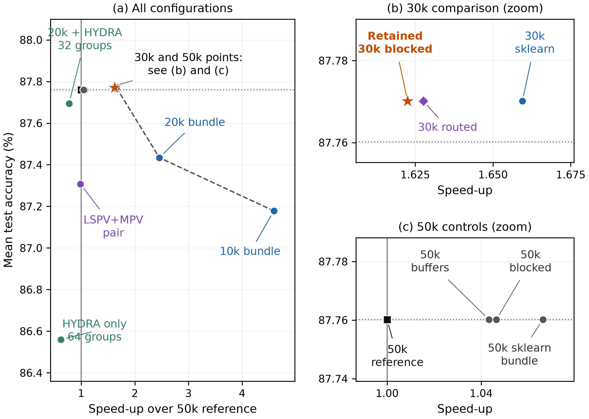

# MultiRocket efficiency experiments

This repository extends [MultiRocket](https://doi.org/10.1007/s10618-022-00844-1)
with a smaller feature budget, blocked ridge fitting, reusable extraction buffers,
and bounded-memory prediction. The recommended univariate configuration uses
**29,568 features and all four pooling operators**. It is feature-budget reduction,
not learned pruning.

On the project's 55-dataset confirmation set, the corrected 30k configuration
was **1.66× faster** and used **31.0% less median paired peak RSS** than a fresh
corrected 50k baseline. Across three accuracy resamples, it met the predeclared
−0.3 percentage-point non-inferiority margin. It did not establish an accuracy gain.

## Environment

Use **Python 3.11** and run commands from the repository root:

```bash
git clone https://github.com/Thilak1907/multi-rocket-improvement.git
cd multi-rocket-improvement
python3.11 -m venv .venv
source .venv/bin/activate
python -m pip install -r requirements-reproduce.txt
python -m unittest discover -s tests -v
```

`requirements-reproduce.txt` pins the numerical packages used for the recorded
CPU experiments. [Environment details](reproducibility/environment.json) record
the platform and thread counts. The main machine has an **Apple M5 CPU, 10
physical cores / 10 logical CPUs, and 24 GiB RAM**, running macOS 26.5.2. The
benchmark uses four Numba/Torch threads and one BLAS thread.

The separate Section IV reproduction checks used a **two-vCPU Linux VM reporting
an Intel Xeon at 2.30 GHz**, with an **8 GB cgroup memory limit**, two
Numba/OpenMP threads, and one OpenBLAS/MKL thread. Its Python 3.13.18 / Numba
0.68.1 stack is recorded separately in
[reproduction/recorded/environment.txt](reproduction/recorded/environment.txt).
The 8 GB limit describes the VM's constrained workload, not installed host RAM.
Other platforms can produce different timings
and small numerical differences. No GPU is required. `requirements.txt` provides
broader runtime constraints for development.

## Data

The experiments use 109 fixed-length datasets from the 2018 UCR archive.
The data and resample indices are **not included in a Git clone**; download
them before running training experiments.

Download sources:

- **Time-series data:** [official UCR 2018 archive page](https://www.cs.ucr.edu/~eamonn/time_series_data_2018/)
  and [direct archive ZIP](https://www.cs.ucr.edu/~eamonn/time_series_data_2018/UCRArchive_2018.zip).
  The [official briefing PDF](https://www.cs.ucr.edu/~eamonn/time_series_data_2018/BriefingDocument2018.pdf)
  contains the public extraction password and archive background.
- **Authors' data metadata and resample indices:** [MultiRocket data directory](https://github.com/ChangWeiTan/MultiRocket/tree/main/data)
  and [indices109 directory](https://github.com/ChangWeiTan/MultiRocket/tree/main/data/indices109).
  These indices define the train/test resamples used in the experiments; they
  are separate from the UCR dataset ZIP.
- **Pinned upstream download used by our script:** [MultiRocket source ZIP](https://codeload.github.com/ChangWeiTan/MultiRocket/zip/3ccaa4f8ed11769b904af885e17018c39c89a2ac).
  Pinning the revision keeps the index files and metadata reproducible.

To download and place both automatically:

```bash
python scripts/download_data.py --upstream --ucr
python scripts/reproduce.py verify
```

The downloader prompts for the public archive password when necessary. It installs:

- TRAIN/TEST TSVs in `data/UCRArchive_2018/<dataset>/`;
- the authors' resample indices in `data/indices109/`;
- dataset metadata and published result CSVs from a pinned upstream revision.

If you already downloaded the archive:

```bash
python scripts/download_data.py --upstream --ucr-archive /path/to/UCRArchive_2018.zip
```

If the TSV files are already extracted, download just the indices and metadata:

```bash
python scripts/download_data.py --upstream
python scripts/reproduce.py verify --data-dir /path/to/UCRArchive_2018
```

For manual placement, extract the UCR ZIP and copy the authors' `indices109`
directory so the repository has this structure (avoid an extra nested archive
directory):

```text
data/
├── UCRArchive_2018/
│   ├── ArrowHead/
│   │   ├── ArrowHead_TRAIN.tsv
│   │   └── ArrowHead_TEST.tsv
│   └── ...
└── indices109/
    ├── ArrowHead_INDICES_TRAIN.txt
    ├── ArrowHead_INDICES_TEST.txt
    └── ...
```

The authors' `data/classification_datasets_109.csv` is also needed by the
collection runner. `--upstream` installs this metadata along with the indices
and published reference results. Run `python scripts/reproduce.py verify`
after placement; do not generate replacement index files.

Existing matching files are reused. Input hashes are checked against the recorded
experiment; a different archive conversion is not silently accepted. Downloads,
raw datasets, local environments, and generated runs are ignored by Git.

## Reproduce results

There are two separate operations.

**Rebuild tables and figures from the supplied measurements** — no datasets or
training required:

```bash
python scripts/reproduce.py summarize all
python scripts/compare_paper.py
```

Reports are generated under `output/reproductions/recorded/<profile>/reports/`.
The checked-in measurements and reports are not overwritten.

**Rerun the corrected experiments from data**:

```bash
python scripts/reproduce.py run review --smoke
python scripts/reproduce.py run review
```

The first command trains only ArrowHead to check setup. The second runs the
component ablation, twelve-configuration comparison, repeated finalist timings,
three-resample accuracy check, ElectricDevices stress test, and legacy replay.
It uses four Numba/Torch threads, one BLAS thread, and a 9 GiB per-worker memory
guard. Allow several hours on a CPU; runtime depends on the machine. Jobs are
resumable. A guard stop is recorded as a failure rather than omitted.

Each rerun uses its recorded runtime sources in an isolated directory under
`output/reproductions/rerun/`. This avoids depending on ignored local protocols
or overwriting the current implementation. Timings will not exactly reproduce
those from another machine.

| Report/result | Rebuild from measurements | Rerun from data |
| --- | --- | --- |
| Main results, ablation, trade-off chart, accuracy interval, stress | `python scripts/reproduce.py summarize review` | `python scripts/reproduce.py run review` |
| Additional-view accuracy experiment | `python scripts/reproduce.py summarize accuracy` | `python scripts/reproduce.py run accuracy` |
| Square-root/log feature experiment | `python scripts/reproduce.py summarize feature-power` | `python scripts/reproduce.py run feature-power` |
| Wider ridge-alpha experiment | `python scripts/reproduce.py summarize ridge-range` | `python scripts/reproduce.py run ridge-range` |
| Earlier legacy combination search | `python scripts/reproduce.py summarize legacy-combinations` | `python scripts/reproduce.py run legacy-combinations` |
| Initial pooling/ridge/memory comparison | `python scripts/reproduce.py summarize legacy-optimization` | Equivalent-settings rerun; see below |
| Initial three-repeat timing study | `python scripts/reproduce.py summarize legacy-initial` | Equivalent-settings rerun; see below |
| Paper/project comparison | `python scripts/compare_paper.py` | Aggregates released and retained CSVs; no training |
| Section IV reproduction checks (seed study, 30-resample comparison with the paper, StarLightCurves/Crop memory); see [reproduction/README.md](reproduction/README.md) | `python reproduction/analyze.py` | `python reproduction/run_all.py A B C` |

The exact model sources for the two earliest optimization studies were not
preserved. Their measurements can be reanalysed, but exact source replay cannot
be claimed. An explicit `--allow-equivalent` flag permits a later legacy
implementation with the same settings. See [the reproduction guide](docs/reproducing.md)
for those commands, output locations, source provenance, and interpretation.

## Results

All rows below use corrected first-difference features on the same 55 dataset
names. Accuracy is resample 1; timings use three repetitions. Speed-up is the
ratio of summed per-dataset median fit-plus-predict times. Memory saving is the
median paired reduction in total process peak RSS.

| Configuration | Accuracy | Speed-up | Peak RSS reduction |
| --- | ---: | ---: | ---: |
| Corrected 50k/sklearn baseline | 87.760% | 1.00× | — |
| **30k/blocked ridge** | **87.770%** | **1.66×** | **31.0%** |
| 30k/size-based ridge | 87.770% | 1.65× | 22.4% |
| 30k/sklearn ridge | 87.770% | 1.68× | 22.3% |
| 10k/four operators | 87.178% | 4.51× | 49.6% |
| 20k + HYDRA | 87.694% | 0.78× | 23.0% |

Across accuracy resamples 1–3, corrected 50k averaged **87.399%**, and retained
30k averaged **87.285%**. The paired change was **−0.114 percentage points**,
with dataset-bootstrap 95% CI **[−0.261, +0.041]**, passing the −0.3-point margin.
Timing repetitions are not independent accuracy resamples.

ElectricDevices completed with fixed 30k in **70.50 s at 6.32 GiB**. The 50k and
30k sklearn variants and the HYDRA hybrid crossed the 9 GiB polling guard.
These are single stress attempts, not measured OS-level OOM events. ElectricDevices is outside the
55-dataset aggregate.



The plot uses the original configuration IDs: `fast30` is the retained
30k blocked-ridge model; `auto30` (the star) is the optional routing experiment.
The dotted horizontal line is reference accuracy, the vertical line marks 1×
speed-up, and the dashed frontier considers accuracy and speed only.

The chart uses one common timing run for all configurations. Full finalist,
stage-time, model-size, and per-dataset results are in the
[corrected report](reports/review_revision/report.md).

### Comparison with the paper

The authors' released result CSVs give the following accuracy values. The
55-dataset rows are our aggregation over the project's confirmation names;
they are not a separate table reported in the paper.

| Source | Datasets | Resamples | Features | Mean accuracy |
| --- | ---: | --- | ---: | ---: |
| Authors' released MultiRocket results | 109 | 30 | 49,728 | 87.967% |
| Authors' results, project subset | 55 | 30 | 49,728 | 87.654% |
| Authors' results, project subset | 55 | Index 1 | 49,728 | 87.987% |
| Project corrected baseline | 55 | Indices 1–3 | 49,728 | 87.399% |
| Project retained configuration | 55 | Indices 1–3 | 29,568 | 87.285% |

At the common index 1 on the same 55 names, the authors' released 50k result
is **87.987%** versus **87.760%** for our corrected 50k reference, a gap of
**0.227 percentage points**; kernel seeds and feature alignment differ, while
the broader accuracy analyses also differ in coverage (30 released resamples
versus our three). These are contextual comparisons, not a paired superiority
test against the paper.
The paper's Table 2 reports 15.77 minutes of 50k training over 112 problems on
its single-thread setup. Our 1.66× claim uses our own paired baseline; we do
not divide timings from different hardware, thread counts, and dataset sets.
The [comparison table](reports/paper_comparison/comparison.md) is regenerated by
`scripts/compare_paper.py` from the released CSVs.

## Use the model

```python
from multirocket.presets import make_multirocket

model = make_multirocket(random_state=20261111)
model.fit(X_train, y_train, predict_on_train=False)
predictions = model.predict(X_test)
```

Inputs have shape `(number_of_series, series_length)`. The preset uses blocked
ridge, buffered extraction, in-place processing, 256-row prediction batches, and
folded scaling. The base constructor still defaults to 50k/sklearn. For one dataset:

```bash
python main_ucr.py -d data/UCRArchive_2018 -p ArrowHead -i 0 -n 30000 -t 4 \
  --classifier fast_ridge --memory-efficient --prediction-batch-size 256 \
  --optimized-transform --fused-prediction --seed 20261111
```

`--legacy-first-difference` reproduces the earlier alignment. `--classifier
auto_ridge` enables the evaluated size switch, which was not adopted. The
multivariate entry point is inherited code and is outside these optimization claims.

## Scope and repository layout

Confirmation dataset names were inspected during earlier development. The
accuracy analysis has three resamples, rather than the paper's 30. Blocked ridge
still has quadratic memory in training cases. Folded scaling retains an extra
coefficient copy, so lower working memory does not imply a smaller saved model.
No general accuracy, multivariate, GPU, or energy improvement is established.
Negative results from optional accuracy experiments are retained in the
[report index](reports/README.md).

```text
multirocket/       model and feature-extraction code
experiments/      benchmark workers and analysis
scripts/          data preparation and reproduction entry points
tests/            numerical and protocol checks
reports/          recorded tables, figures, and conclusions
reproducibility/  checksummed measurements, pinned sources, environment metadata
docs/             method and reproduction notes
```

[Implementation notes](docs/technical_report.md) explain the algorithms and
changes. [Reproduction details](docs/reproducing.md) describe every experiment.

## Attribution and license

This project builds on the authors' [MultiRocket repository](https://github.com/ChangWeiTan/MultiRocket).
Please cite:

```bibtex
@article{tan2022multirocket,
  title={MultiRocket: multiple pooling operators and transformations for fast and effective time series classification},
  author={Tan, Chang Wei and Dempster, Angus and Bergmeir, Christoph and Webb, Geoffrey I.},
  journal={Data Mining and Knowledge Discovery},
  volume={36},
  pages={1623--1646},
  year={2022},
  doi={10.1007/s10618-022-00844-1}
}
```

See [LICENSE](LICENSE). Vendored HYDRA code retains its
[upstream attribution and GPL-3.0 license](experiments/vendor/README.md).
