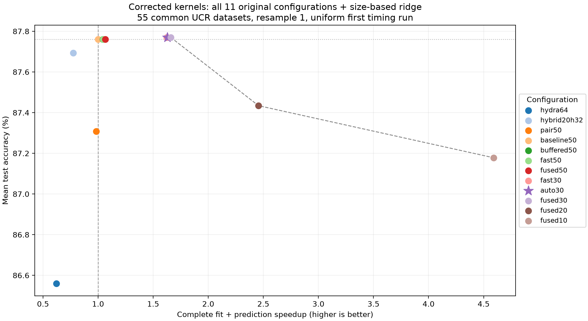

# MultiRocket

**Multiple pooling operators and transformations for fast and effective time series classification.**

MultiRocket extracts convolution features from raw time series and their first
order differences, using four pooling operators: PPV, LSPV, MPV, and MIPV.
This repository includes the original implementation and an evaluated set of
optimizations for the univariate ridge pipeline.

[Original paper](https://arxiv.org/abs/2102.00457) ·
[Current benchmark report](reports/review_revision/report.md) ·
[All reports](reports/README.md)

## Recommended configuration

Use **30k features, all four pooling operators, blocked ridge, buffered
extraction, in-place processing, 256-row prediction batches, and folded
scaling**. The nominal 30k budget produces **29,568 feature columns**.

The size-based sklearn/blocked-ridge switch was implemented and evaluated, but
it did not meet the predeclared requirement of a 3% runtime improvement over
the fixed blocked backend. The fixed backend remains the recommendation.

Corrected first-difference alignment is enabled: a differenced series has length
`L-1`, and the convolution accumulation now uses that length. Earlier experiments
used the legacy alignment. Their results remain available separately.

## Setup

Run commands from the repository root. The corrected experiments used Python
3.11. Exact NumPy, SciPy, sklearn, Numba, and Torch versions are recorded in
the local `output/review_revision/corrected_v1/protocol.json`.

```bash
python3 -m venv .venv
source .venv/bin/activate
python -m pip install numpy scipy pandas numba scikit-learn psutil pytz
```

For benchmark plots and the HYDRA comparisons, also install:

```bash
python -m pip install matplotlib torch
```

These commands install the working dependencies without pinning a reproduction
environment. `requirements.txt` retains the original project's older pins,
including a CUDA-specific Torch build; it is not the environment used for the
corrected benchmarks. The multivariate runner additionally requires `sktime`.

## Run a dataset

Place the UCR archive under `data/UCRArchive_2018`, with one directory per
dataset containing its TRAIN and TEST files. Run the recommended bundle with:

```bash
python main_ucr.py -d data/UCRArchive_2018 -p ArrowHead -i 0 -n 30000 -t 4 \
  --classifier fast_ridge --memory-efficient --prediction-batch-size 256 \
  --optimized-transform --fused-prediction --seed 20261111
```

Results are written under `output/multirocket/`. Configuration-specific names
and the `_diff1fixed` suffix distinguish corrected runs from legacy output.

| Entry point | Purpose |
| --- | --- |
| `main_ucr.py` | Run one univariate UCR dataset |
| `main_ucr_109.py` | Run the 109-dataset UCR collection |
| `main_mtsc.py` | Run a multivariate dataset using the original pipeline |

Use `python main_ucr.py --help` for the full CLI. Common options are `-d` for the
archive path, `-p` for the dataset, `-i` for the resample, `-n` for the feature
budget, `-t` for threads, and `--seed` for reproducible kernel generation.
The optimization flags described here apply to the univariate implementation.

### Python usage

```python
from multirocket.presets import make_multirocket

# X_train and X_test: arrays shaped (number of series, series length).
model = make_multirocket(random_state=20261111)
model.fit(X_train, y_train, predict_on_train=False)
predictions = model.predict(X_test)
```

| Preset | Configuration |
| --- | --- |
| `previous30` (recommended) | Corrected features and the fixed blocked-ridge bundle |
| `candidate30` | Corrected features with size-based ridge selection |
| `legacy30` | Previous bundle with legacy first-difference alignment |

The base `MultiRocket` constructor and CLI retain their 50k/sklearn defaults;
use the factory or explicit CLI flags to select the recommended 30k bundle.

### Optional configurations

- `--classifier auto_ridge` selects sklearn below 693 MiB of estimated training
  features and blocked ridge at or above it. The estimate is
  `n_train * actual_feature_columns * 4`; change the threshold with
  `--ridge-feature-limit-mib`.
- `--legacy-first-difference` reproduces the original alignment.
- `--pooling LSPV+MPV` retains a selected pair. The feature budget still specifies
  the original four-operator kernel budget, so removing two operators halves
  the columns rather than adding replacement kernels.
- A nominal 10k budget offers greater speed and memory savings with an observed
  accuracy cost. It is an alternative trade-off, rather than the default.

## Measured results

The table uses **corrected features throughout**, with 55 confirmation datasets
on resample 1 and three timing repetitions for each finalist. Speed-up compares
summed per-dataset median fit-plus-predict times with the corrected 50k baseline.
Memory savings are the median paired reductions in process peak RSS.

| Configuration | Mean accuracy | Overall speed-up | Peak RSS reduction |
| --- | ---: | ---: | ---: |
| Corrected 50k reference | 87.760% | 1.00× | — |
| **30k + blocked ridge** | **87.770%** | **1.66×** | **31.0%** |
| 30k + size-based ridge | 87.770% | 1.65× | 22.4% |
| 30k + sklearn ridge | 87.770% | 1.68× | 22.3% |
| 10k, four operators | 87.178% | 4.51× | 49.6% |
| 20k + HYDRA | 87.694% | 0.78× | 23.0% |

Baseline, fixed 30k, and routed 30k were additionally evaluated on resamples 2
and 3. Across all three accuracy resamples, the paired mean change for fixed
30k was **−0.114 percentage points**, with a dataset-bootstrap 95% interval of
**[−0.261, +0.041]**. This passes the predeclared **−0.3-point non-inferiority
margin**, supporting no material mean loss within that margin. It does not
establish an accuracy gain or equal accuracy on every dataset. Timing repetitions
are not additional accuracy resamples.

On **ElectricDevices**, fixed 30k completed in **70.50 seconds at 6.32 GiB** peak
RSS. Both the corrected 50k reference and 30k sklearn variant crossed the 9 GiB
polling guard. These are single stress attempts; guard stops are not proof of
operating-system OOM failures. ElectricDevices is excluded from the 55-dataset
confirmation aggregates.



The chart uses one common timing repetition for all eleven original
configurations plus size routing; the finalist table above uses three.
The [full report](reports/review_revision/report.md) includes balanced accuracy,
macro F1, fit and prediction stages, model size, per-dataset changes, alpha and
prediction parity, ablation, and the adoption decision.

### Interpretation and limits

- The older **1.45× / +0.153-point** result belongs to the legacy alignment and
  earlier benchmark run. See the [previous combination search](reports/combination_search/report.md).
- The current evaluation has three accuracy resamples, rather than the paper's
  30. Dataset names were inspected during earlier development, so confirmation
  is not a newly independent collection. Paper/repository comparisons are kept
  separate in the [optimization report](reports/optimization_comparison/report.md).
- Timings exclude imports, loading, and JIT warmup; process RSS includes them.
  Runs use four Numba/Torch threads and one BLAS thread. Speed-ups are local
  paired measurements, not comparisons against the paper's hardware.
- Blocked ridge still requires quadratic memory in training cases and an
  eigendecomposition. Folded scaling keeps an extra coefficient copy, increasing
  saved model size. No energy or GPU measurements were made.

## Reproduce the experiments

The `experiments/` folder contains the benchmark runners and report generators.
Keep it to reproduce the comparisons; it is not needed for ordinary prediction.

```bash
VECLIB_MAXIMUM_THREADS=1 OPENBLAS_NUM_THREADS=1 OMP_NUM_THREADS=4 \
  python -m experiments.review_revision --stage all
python -m experiments.summarize_revision
```

The runner records the selection/confirmation split, frozen choices, source
hashes, dataset indices, seeds, and per-job measurements under
`output/review_revision/corrected_v1`. Final summaries and figures are written
to `reports/review_revision`. Raw output, datasets, and the virtual environment
are excluded from Git; retained CSVs accompany the reports.

## Tests

```bash
python -m unittest discover -s tests -v
```

Tests cover ridge alpha/prediction parity, pooling, buffered extraction,
first-difference convolution against an independent oracle, preset selection,
size-routing boundaries, and experiment statistics.

## Citation

Please cite the original MultiRocket work when using this implementation:

```bibtex
@article{Tan2021MultiRocket,
  title={{MultiRocket}: Multiple pooling operators and transformations for fast and effective time series classification},
  author={Tan, Chang Wei and Dempster, Angus and Bergmeir, Christoph and Webb, Geoffrey I},
  year={2021},
  journal={arxiv:2102.00457}
}
```

## License and acknowledgements

See [LICENSE](LICENSE). The vendored HYDRA reference implementation retains its
[GPL-3.0 license and attribution](experiments/vendor/README.md).
Thanks to the MultiRocket authors and the maintainers of the
[UCR time series archive](https://www.cs.ucr.edu/~eamonn/time_series_data_2018/).
