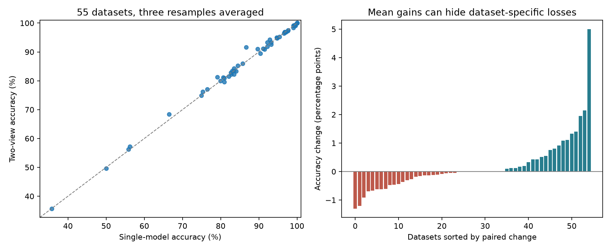

# Accuracy addition: two-view ensemble

The baseline remains the corrected 30k bundle: all four pooling operators, blocked ridge, buffered extraction, in-place processing, 256-row prediction batches, and folded scaling.

Each candidate adds one more complete 30k member and averages its ridge decision scores equally with the baseline. Total feature columns become 59,136 across two members, with separate ridge fits; this is extra work, not a same-cost accuracy improvement.

Candidates: another kernel seed; per-series z-normalization (constants become zeros); and pair-averaged, half-rate series (lengths below 20 retain the original series). The added member uses seed +104729 modulo 2^32 in every candidate.

## Selection

Candidates are compared on stratified 80/20 partitions of the official TRAIN files for the 54 selection datasets, capped at 512 series per partition. Official TEST labels are not used for choosing a candidate. The winner must improve mean validation accuracy by at least 0.1 percentage points and take at most 2.5 times baseline summed runtime. Choice, input hashes, and sources are frozen before confirmation.

| Addition | Validation accuracy | Change | Runtime / baseline |
| --- | ---: | ---: | ---: |
| seed | 85.037% | -0.319 pp | 1.98× |
| normalized | 85.085% | -0.270 pp | 1.98× |
| coarse | 85.946% | +0.591 pp | 1.56× |

Frozen candidate: **coarse**.

## Paired confirmation

On 55 datasets across archive resamples 1, 2, and 3: **+0.171 percentage points**, paired dataset-bootstrap 95% CI **[-0.055, +0.444]**. Datasets, not 165 dataset/resample rows, are the statistical units. Bootstrap: 20,000 draws, seed 421.

Summed fit-plus-predict runtime: **1.62× baseline**. Per-dataset wins/ties/losses after averaging three resamples: **20/11/24** (tie tolerance 1e-10 percentage points).

| Model | Accuracy | Balanced accuracy | Macro F1 | Mean fit s | Mean predict s | Mean model MiB |
| --- | ---: | ---: | ---: | ---: | ---: | ---: |
| baseline | 87.285% | 85.634% | 85.453% | 0.748 | 0.900 | 2.44 |
| coarse | 87.457% | 85.777% | 85.642% | 1.288 | 1.381 | 4.89 |

**Decision: retain the existing bundle; the candidate did not pass the predeclared gain/runtime gate.**

## Costs and limits

Timing has one run per split; small speed differences are descriptive. Baseline features/scores are reused across candidates, and candidate order is rotated by dataset. Imports, loading, and warmup are excluded. Input-view processing is included in candidate fit/predict times. Models fit sequentially and do not retain training features.

Process RSS is a shared high-water upper bound, including imports/warmup and previous candidate fits; it is not an isolated per-candidate memory measurement. Every job has a 9 GiB polling guard. Reported model bytes sum the serialized members, excluding small wrapper metadata.

The confirmation dataset names were inspected during previous development. These are follow-up paired measurements, not untouched external validation, and resamples reuse examples. No claim of a universal accuracy gain, energy efficiency, or GPU performance is made.

Rebuild the recorded tables with `python scripts/reproduce.py summarize accuracy`. For new measurements use `python scripts/reproduce.py run accuracy`. See [reproduction details](../../docs/reproducing.md) for data, source versions, and limitations.

Background: [MultiRocket paper](https://arxiv.org/abs/2102.00457).
