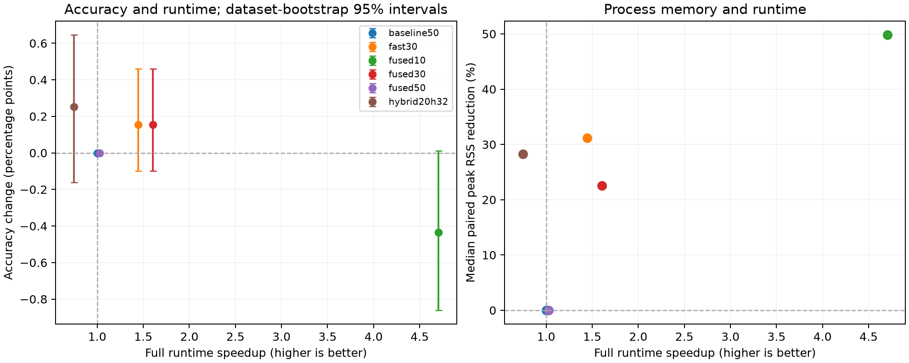

> **Legacy results:** these runs preserve the original first-difference alignment and do not include the L−1 correction. The corrected, size-based-ridge review is recorded separately in `reports/review_revision`. Previous figures remain available for comparison.

# Best overall combination experiment

Recommended conservative preset: **fast30** — retain all four operators at a nominal 30,000-feature budget (29,568 actual columns), use blocked ridge, buffered extraction, in-place cleaning/scaling, prediction batches of 256, and folded scaling. On this confirmation split it gives 87.841% mean accuracy (+0.153 pp), 1.45x full-runtime speedup and 31.2% lower median paired peak RSS. Its mean accuracy change is an observed result; the bootstrap interval below describes its uncertainty. The 10k option is faster with an accuracy cost, while the hybrid has the highest observed mean accuracy and greater runtime. Classifier fitting alone takes 7.8% longer, and median fitted-model pickle size is 5.9% larger. Full fitting and prediction still improve because feature extraction is cheaper. Folded prediction retains an extra coefficient copy.

Frozen balanced candidate: **fused10**. Accuracy candidate: **hybrid20h32**. Fastest eligible candidate: **fused10**.

The original finalist list was frozen before confirmation. The balanced rule allows at most 0.5 percentage points lower mean selection accuracy than the original 50k baseline, then minimizes the square root of the total runtime ratio times the median paired peak-RSS ratio. This is an explicit preference, not a claim that one model wins every metric.

Conservative candidate: **fused30**, selected by a separate frozen rule: Fastest complete selection candidate with no observed mean validation accuracy loss. This addition uses selection scores only and was frozen before that candidate was confirmed. The original choice remains unchanged in choice.json; the added rule and input hashes are in extra_choice.json.

## Selection on training data

Ten initial candidates were attempted on all 54 original selection datasets. Only their official TRAIN data were split into approximately 80/20 training/validation subsets: at least one item from each non-singleton class enters validation and at least one stays in training. Singleton classes remain in training. Small classes can therefore have a larger validation fraction. No official TEST labels were used to rank candidates. Each candidate uses the same subset and kernel seed for a dataset.

| variant | datasets | accuracy | delta_pp | time_ratio | rss_ratio | cost_score | successful |
| --- | --- | --- | --- | --- | --- | --- | --- |
| baseline50 | 54 | 86.095% | +0.000 | 1.000 | 1.000 | 1.000 | 54 |
| buffered50 | 53 | 85.998% | +0.000 | 0.941 | 1.000 | 0.970 | 53 |
| fused50 | 53 | 85.998% | +0.000 | 0.961 | 1.001 | 0.981 | 53 |
| fused30 | 54 | 86.245% | +0.150 | 0.716 | 0.856 | 0.783 | 54 |
| fused20 | 54 | 85.258% | -0.836 | 0.619 | 0.769 | 0.690 | 54 |
| fused10 | 54 | 85.682% | -0.412 | 0.458 | 0.672 | 0.555 | 54 |
| fast50 | 54 | 86.095% | +0.000 | 0.947 | 0.993 | 0.970 | 54 |
| pair50 | 54 | 86.371% | +0.277 | 0.893 | 0.733 | 0.809 | 54 |
| hydra64 | 54 | 85.831% | -0.264 | 0.888 | 0.695 | 0.785 | 54 |
| hybrid20h32 | 54 | 86.781% | +0.686 | 1.034 | 0.832 | 0.928 | 54 |
| fast30 | 54 | 86.245% | +0.150 | 1.216 | 0.784 | 0.976 | 54 |

A targeted eleventh configuration, **fast30**, replaces fused30's sklearn ridge with blocked ridge. It was motivated by selection-only ElectricDevices memory: fused30 reached 8.91 GiB, while fast50 used 6.47 GiB. All 54 selection predictions and alphas had to match fused30 before its confirmation was unlocked. Its separate immutable protocol and results are in `output/combination_search/20261111_fast30`.

Configuration names: baseline50 = original four operators, sklearn ridge, copying and full prediction; buffered50 = four operators, reused transform scratch, in-place cleaning/scaling, batches of 256; fused50 = buffered50 plus folded scaling at prediction. fused30/20/10 use the same changes at nominal budgets 30k/20k/10k. fast50 also uses the blocked ridge backend. pair50 retains LSPV+MPV with fast ridge, in-place operations, folded scaling and batching. hydra64 uses the official HYDRA transform with 64 groups and SparseScaler. hybrid20h32 combines buffered 20k four-operator MultiRocket with 32-group HYDRA; the two blocks use their respective scalers before a shared sklearn ridge classifier.

## Confirmation on archive resample 1

Completed successful jobs: **990/990** across 55 dataset names and 3 timing repetition(s). The finalist list was frozen from selection: baseline50, fused10, hybrid20h32, fused50, fused30, fast30.
This uses a different archive resample from the previous resample-0 experiment. It reuses the same underlying examples and dataset names, so it is confirmation on another split, not an entirely new independent dataset collection. Results were not used to change the frozen candidates.

| variant | datasets | accuracy | delta_pp | wins | ties | losses | total_s | speedup | median_rss_reduction_pct | pareto |
| --- | --- | --- | --- | --- | --- | --- | --- | --- | --- | --- |
| baseline50 | 55 | 87.688% | +0.000 | 0 | 55 | 0 | 176.42 | 1.00x | 0.0% | False |
| fast30 | 55 | 87.841% | +0.153 | 19 | 18 | 18 | 122.06 | 1.45x | 31.2% | True |
| fused10 | 55 | 87.252% | -0.436 | 10 | 17 | 28 | 37.51 | 4.70x | 49.9% | True |
| fused30 | 55 | 87.841% | +0.153 | 19 | 18 | 18 | 109.84 | 1.61x | 22.5% | True |
| fused50 | 55 | 87.688% | +0.000 | 0 | 55 | 0 | 171.54 | 1.03x | 0.0% | False |
| hybrid20h32 | 55 | 87.940% | +0.252 | 29 | 15 | 11 | 236.54 | 0.75x | 28.2% | True |

- **Balanced: fused10** — 87.252% accuracy (-0.436 pp), 4.70x full-runtime speedup, 49.9% median paired peak-RSS reduction. Largest dataset accuracy loss: -5.556 pp.
- **Conservative: fused30** — 87.841% accuracy (+0.153 pp), 1.61x full-runtime speedup, 22.5% median paired peak-RSS reduction. Largest dataset accuracy loss: -1.556 pp.
- **Conservative with fast ridge: fast30** — 87.841% accuracy (+0.153 pp), 1.45x full-runtime speedup, 31.2% median paired peak-RSS reduction. Largest dataset accuracy loss: -1.556 pp.
- **Accuracy: hybrid20h32** — 87.940% accuracy (+0.252 pp), 0.75x full-runtime speedup, 28.2% median paired peak-RSS reduction. Largest dataset accuracy loss: -6.444 pp.

Runtime is complete fit plus prediction, summed across the paired datasets; startup, loading and warmup are excluded. Values above 1x are faster. Process peak RSS includes imports, inputs and warmup, and is supervised at 50ms intervals. It is different from feature-array memory. Pareto means no measured finalist is at least as good on accuracy, runtime and median peak RSS with a strict improvement in one.

| variant | fit_s | predict_s | train_transform_s | test_transform_s | classifier_fit_s | classifier_predict_s | test_cases_per_s |
| --- | --- | --- | --- | --- | --- | --- | --- |
| baseline50 | 71.48 | 105.04 | 44.27 | 99.49 | 20.64 | 1.50 | 373.58 |
| fast30 | 55.72 | 66.15 | 30.56 | 63.95 | 22.26 | 0.69 | 593.22 |
| fused10 | 18.18 | 18.97 | 8.00 | 18.44 | 8.67 | 0.18 | 2068.27 |
| fused30 | 45.57 | 64.16 | 27.93 | 62.20 | 14.20 | 0.59 | 611.62 |
| fused50 | 71.64 | 100.43 | 46.69 | 97.13 | 20.39 | 0.96 | 390.73 |
| hybrid20h32 | 84.21 | 151.07 | 69.42 | 149.92 | 12.51 | 1.15 | 259.74 |

All stage times are seconds, summed per-dataset medians. Classifier times include the relevant scaling work; total times also include kernel generation, differencing, cleaning and batching overhead. Medians of stage times do not have to add exactly to the median of their total. test_cases_per_s is aggregate batch throughput, not the latency of a single online request.

| variant | balanced_accuracy | macro_f1 | median_features | median_train_feature_mib | median_test_batch_mib | median_rss_gib | max_rss_gib | median_model_mib |
| --- | --- | --- | --- | --- | --- | --- | --- | --- |
| baseline50 | 86.196% | 86.122% | 49728 | 34.34 | 58.43 | 1.04 | 6.91 | 1.95 |
| fast30 | 86.380% | 86.310% | 29568 | 20.42 | 28.88 | 0.62 | 2.66 | 2.06 |
| fused10 | 85.615% | 85.550% | 9408 | 6.50 | 9.19 | 0.48 | 1.83 | 0.66 |
| fused30 | 86.380% | 86.310% | 29568 | 20.42 | 28.88 | 0.65 | 4.41 | 2.06 |
| fused50 | 86.196% | 86.122% | 49728 | 34.34 | 48.56 | 0.82 | 6.97 | 3.46 |
| hybrid20h32 | 86.394% | 86.293% | 22560 | 15.93 | 5.37 | 0.59 | 4.08 | 0.90 |

The median of paired RSS reductions is a different statistic from the reduction of the two median RSS values. Model size is the Python pickle size of the fitted model, including kernel parameters and coefficients, measured after the timed run. All raw records contain classifier/transform times, alpha and prediction hashes.

Repeat stability: 330/330 dataset/configuration pairs have identical predictions across their completed timing repetitions; 330/330 have identical alpha. Full records are in repeat_stability.csv. Maximum RSS above is the largest observed successful-job peak, rather than a median.

runtime_by_repeat.csv records the full fit/predict sums and dataset counts for each timing repetition. The main table sums per-dataset median times, which need not equal the median of the three run-level sums.

## Accuracy uncertainty

- baseline50: mean difference +0.000 pp; dataset-bootstrap 95% interval [+0.000, +0.000] pp.
- fast30: mean difference +0.153 pp; dataset-bootstrap 95% interval [-0.098, +0.460] pp.
- fused10: mean difference -0.436 pp; dataset-bootstrap 95% interval [-0.861, +0.010] pp.
- fused30: mean difference +0.153 pp; dataset-bootstrap 95% interval [-0.098, +0.460] pp.
- fused50: mean difference +0.000 pp; dataset-bootstrap 95% interval [+0.000, +0.000] pp.
- hybrid20h32: mean difference +0.252 pp; dataset-bootstrap 95% interval [-0.162, +0.647] pp.

Intervals resample dataset-level differences. They do not represent variation across 30 training resamples, and the selection accuracy threshold does not guarantee the same accuracy margin on confirmation.

## Dataset-level tradeoffs

Largest losses and gains for the balanced, conservative and accuracy candidates are shown below. Every dataset and all stage metrics are in per_dataset.csv.

**fused10**

| dataset | baseline_accuracy | accuracy | delta_pp | speedup |
| --- | --- | --- | --- | --- |
| SemgHandMovementCh2 | 82.222% | 76.667% | -5.556 | 4.76x |
| RefrigerationDevices | 76.267% | 72.267% | -4.000 | 5.48x |
| OliveOil | 93.333% | 90.000% | -3.333 | 3.69x |
| Wine | 90.741% | 96.296% | +5.556 | 3.16x |
| Haptics | 53.896% | 57.468% | +3.571 | 5.19x |
| ECG200 | 88.000% | 90.000% | +2.000 | 4.45x |

**fast30**

| dataset | baseline_accuracy | accuracy | delta_pp | speedup |
| --- | --- | --- | --- | --- |
| SemgHandMovementCh2 | 82.222% | 80.667% | -1.556 | 1.92x |
| RefrigerationDevices | 76.267% | 74.933% | -1.333 | 1.97x |
| InlineSkate | 52.364% | 51.091% | -1.273 | 0.83x |
| Wine | 90.741% | 96.296% | +5.556 | 1.60x |
| ECG200 | 88.000% | 90.000% | +2.000 | 1.06x |
| Haptics | 53.896% | 55.519% | +1.623 | 0.81x |

**hybrid20h32**

| dataset | baseline_accuracy | accuracy | delta_pp | speedup |
| --- | --- | --- | --- | --- |
| SemgHandMovementCh2 | 82.222% | 75.778% | -6.444 | 0.75x |
| OliveOil | 93.333% | 90.000% | -3.333 | 0.71x |
| MiddlePhalanxOutlineAgeGroup | 66.883% | 64.935% | -1.948 | 1.10x |
| Wine | 90.741% | 96.296% | +5.556 | 0.61x |
| ProximalPhalanxOutlineCorrect | 89.003% | 91.409% | +2.405 | 1.08x |
| CricketX | 83.333% | 85.385% | +2.051 | 0.90x |

## Numerical parity

| phase | variant | reference | jobs | alpha_matches | minimum_prediction_agreement |
| --- | --- | --- | --- | --- | --- |
| confirmation | fast30 | fused30 | 165 | 165 | 100.000000% |
| confirmation | fused50 | baseline50 | 165 | 165 | 100.000000% |
| selection | buffered50 | baseline50 | 53 | 53 | 100.000000% |
| selection | fast30 | fused30 | 54 | 54 | 100.000000% |
| selection | fast50 | baseline50 | 54 | 54 | 100.000000% |
| selection | fused50 | baseline50 | 53 | 53 | 100.000000% |

Buffered scratch preserves the pooling definitions. Folded scaling is mathematically equivalent but changes floating-point rounding; the table gives observed prediction agreement rather than a universal bitwise guarantee.

## Published reference

On these 55 dataset names the published 50k MultiRocket accuracy is 87.987% on resample 1 and 87.654% for its 30-resample mean. These are contextual references with different kernel seeds and software/hardware. Fresh paired baseline jobs are used for improvement claims.

## ElectricDevices stress

| variant | status | accuracy | total_s | peak_rss_bytes | features |
| --- | --- | --- | --- | --- | --- |
| baseline50 | ok | 90.637% | 80.65 | 8.04 GiB | 49728 |
| fused10 | ok | 90.053% | 53.56 | 5.13 GiB | 9408 |
| fused30 | rss_limit | — | — | 9.23 GiB | — |
| fused50 | rss_limit | — | — | 9.01 GiB | — |
| hybrid20h32 | ok | 90.987% | 66.89 | 8.41 GiB | 21536 |
| fast30 | ok | 90.248% | 92.51 | 6.32 GiB | 29568 |

ElectricDevices belongs to the selection half and is excluded from held-out confirmation averages. Stress uses one attempt per variant. rss_limit means the 9 GiB experiment guard stopped the process; it does not establish an operating-system OOM.

The original baseline also completed this resample. fast30 lowers peak RSS from 8.04 to 6.32 GiB (21.4% lower), but total runtime rises from 80.65 to 92.51 seconds (14.7% longer). Accuracy changes from 90.637% to 90.248% (-0.389 pp). The 55-dataset average gains do not apply to every dataset.

## Optional backend routing analysis

A selection-only size-based routing analysis chose 6,144 training cases as a switch: sklearn below this count, blocked ridge at or above it. The objective is the same time/RSS geometric score, with a maximum selection RSS of 8 GiB to leave 1 GiB below the experiment guard. This combines existing measured paths; an additional adaptive wrapper was not timed. All 55 confirmation datasets fall below this threshold and therefore use the measured fused30 path. ElectricDevices uses fast30. See backend_routing_selection.csv and backend_routing.json for every threshold and input hash. The fixed fast30 recommendation favors consistent memory headroom over this optional throughput policy.

## Reproduction and limits

Single-machine CPU measurements with four Numba/Torch threads, one BLAS thread, warm JIT and rotated execution order for the initial finalists. The fast30 refinement runs separately after them. HYDRA uses adaptive batches to bound convolution scratch; MultiRocket batches are 256. Every job runs in a fresh process. Exact source, dataset and resample-index hashes, package versions, choice hashes and raw predictions are retained in `output/combination_search/20261111_repeats3`.

This is a finite candidate search; thread-count sweeps, GPU execution, iterative ridge solvers, learned feature pruning, energy use, and a full 30-resample replication were not measured. Blocked ridge still requires quadratic memory in training cases and a cubic eigendecomposition; it is not a streaming solver. Classifier alpha uses the default leave-one-out squared-error objective. HYDRA is the upstream GPL-3.0 implementation from https://github.com/angus924/hydra; its source and license are included under experiments/vendor.

The initial search and repetition commands are documented in README.md. Existing protocols reject source changes rather than mixing implementations. The repetition driver records where unchanged selection and first-repeat results were reused. All job failures, including selection and guard stops, are in failures.csv.

Generate this report with `.venv/bin/python -m experiments.summarize_combinations --output output/combination_search/20261111_repeats3 --refinement-output output/combination_search/20261111_fast30`.
