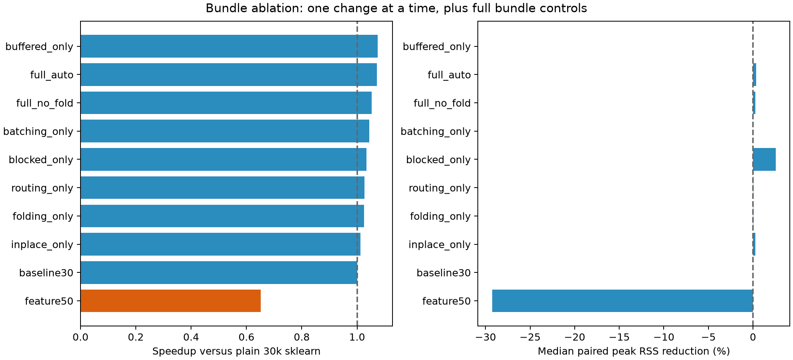
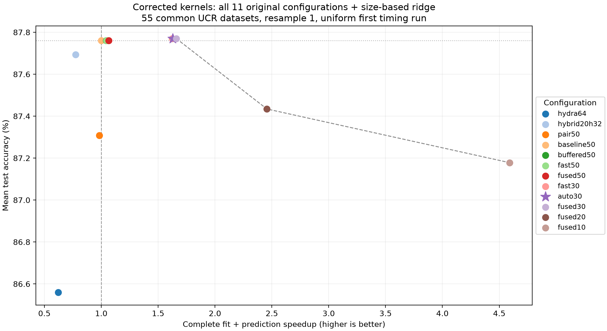

# Corrected MultiRocket review

Accuracy unchanged within the predeclared 0.3-point non-inferiority margin (-0.114 pp; dataset-bootstrap 95% CI [-0.261, +0.041]).

**Decision: retain the previous backend preset; adoption gates did not all pass.**
Failed/incomplete gates: runtime_gain_at_least_3pct.

## First-difference audit

Earlier reports used legacy first-difference features. The difference array has length L-1 but the original transform used L when accumulating the left shifts. The corrected transforms use L-1. Raw-series features and pooling definitions are unchanged. Independent direct-correlation tests cover multiple lengths/dilations, constant series, all operators and pairs; buffered and unbuffered corrected features are also checked on float data. All new comparisons below, including the 50k reference and HYDRA hybrid, use corrected kernels. Standalone HYDRA has no MultiRocket difference kernel.

The original transform and buffered implementation remain available behind first_difference_fix=False / --legacy-first-difference. The prior report is archived in reports/combination_search; the prior source snapshot is in output/combination_search/previous_implementation. Legacy replay results are in legacy_replay.csv. Old and corrected metrics are not pooled.

## Size-based ridge

The switch uses estimated training feature bytes = training rows × actual feature columns × 4. At 30k nominal there are 29,568 columns. Below 693 MiB use sklearn ridge; at or above 693 MiB use blocked ridge. This is the previous selection-derived 6,144-row threshold expressed in bytes, not retuned on new confirmation labels. The selected backend is logged for every job.

## Six-finalist confirmation

990/990 successful finalist timing jobs on resample 1. Three timing repetitions reuse the same split and seed. They are not three accuracy resamples. The table sums per-dataset median times; stage medians need not sum exactly to the median of their total.

| variant | datasets | accuracy | delta_pp | total_s | speedup | rss_reduction_pct |
| --- | --- | --- | --- | --- | --- | --- |
| auto30 | 55 | 87.770% | +0.010 | 96.69 | 1.65x | 22.4% |
| baseline50 | 55 | 87.760% | +0.000 | 159.65 | 1.00x | 0.0% |
| fast30 | 55 | 87.770% | +0.010 | 96.33 | 1.66x | 31.0% |
| fused10 | 55 | 87.178% | -0.582 | 35.38 | 4.51x | 49.6% |
| fused30 | 55 | 87.770% | +0.010 | 95.15 | 1.68x | 22.3% |
| hybrid20h32 | 55 | 87.694% | -0.066 | 204.98 | 0.78x | 23.0% |

| variant | wins | ties | losses | worst_delta_pp | best_delta_pp |
| --- | --- | --- | --- | --- | --- |
| auto30 | 18 | 18 | 19 | -3.333 | +5.556 |
| baseline50 | 0 | 55 | 0 | +0.000 | +0.000 |
| fast30 | 18 | 18 | 19 | -3.333 | +5.556 |
| fused10 | 10 | 14 | 31 | -5.111 | +5.556 |
| fused30 | 18 | 18 | 19 | -3.333 | +5.556 |
| hybrid20h32 | 22 | 13 | 20 | -5.778 | +5.556 |

Wins/ties/losses and extreme changes above compare each dataset to the corrected 50k reference on resample 1. The non-inferiority statement below concerns the mean paired difference, not every dataset.

| variant | fit_s | predict_s | balanced_accuracy | macro_f1 | median_rss_gib | max_rss_gib | model_mib |
| --- | --- | --- | --- | --- | --- | --- | --- |
| auto30 | 42.04 | 54.72 | 86.292% | 86.214% | 0.66 | 4.41 | 2.06 |
| baseline50 | 67.81 | 91.79 | 86.297% | 86.194% | 1.04 | 6.24 | 1.95 |
| fast30 | 42.78 | 53.48 | 86.292% | 86.214% | 0.62 | 2.66 | 2.06 |
| fused10 | 18.67 | 16.68 | 85.473% | 85.422% | 0.49 | 1.83 | 0.66 |
| fused30 | 41.02 | 54.22 | 86.292% | 86.214% | 0.66 | 4.41 | 2.06 |
| hybrid20h32 | 75.46 | 129.45 | 86.164% | 86.074% | 0.60 | 4.10 | 0.90 |

The frozen bundle choice and all flags are in decision.json and the experiment bundle_choice.json. Full per-dataset results, training/prediction feature buffers, stage times and model sizes are in the accompanying CSVs.

Timing-repeat stability: 660/660 dataset/configuration pairs have one prediction hash; 660/660 have one alpha. Exact records are in repeat_stability.csv.

## Accuracy and non-inferiority

Before these runs, the acceptable mean loss was set to 0.3 percentage points. The primary statistical units are the 55 datasets: average each paired accuracy difference over resamples 1, 2 and 3, then test those dataset means against -0.3 pp. We require a one-sided paired-difference t-test at alpha .05 and a two-sided dataset-bootstrap 95% lower bound above -0.3 pp. A two-level dataset/resample bootstrap is also reported as sensitivity analysis. These are benchmark-level statements, not guarantees for individual datasets or external populations.

| variant | datasets | resamples | mean_delta_pp | ci_low_pp | ci_high_pp | p_value | noninferior |
| --- | --- | --- | --- | --- | --- | --- | --- |
| fast30 | 55 | 3 | -0.114 | -0.261 | +0.041 | 0.01023 | True |
| auto30 | 55 | 3 | -0.114 | -0.261 | +0.041 | 0.01023 | True |

| variant | hierarchical_ci_low_pp | hierarchical_ci_high_pp | one_sided_t_lower_pp |
| --- | --- | --- | --- |
| fast30 | -0.299 | +0.086 | -0.244 |
| auto30 | -0.299 | +0.086 | -0.244 |

Resamples reuse underlying examples, and UCR datasets can be related. We do not treat all 165 dataset/resample pairs as independent observations. “Unchanged” means no loss beyond the predeclared margin under this benchmark analysis; it does not establish equality. No claim of an accuracy gain is made. The paired-difference test uses [SciPy ttest_1samp](https://docs.scipy.org/doc/scipy/reference/generated/scipy.stats.ttest_1samp.html).

Runtime sensitivity across complete resamples is retained in runtime_by_resample.csv. Resample 1 has three timing repetitions; resamples 2 and 3 have one timing each and are secondary timing evidence. They do not replace the predeclared resample-1 default-adoption comparison.

## Bundle ablation

This quick ablation uses 12 workload-selected datasets from the selection half, internal stratified validation, caps of 512 training and 512 validation cases, and three timing repetitions. It is for component cost and parity, not for claiming archive accuracy. Every single-change row starts from plain corrected 30k sklearn. feature50 provides the feature-budget control. full_auto and full_no_fold test the complete bundle.

On these capped cases routing_only selects the same sklearn backend as baseline30. Its apparent runtime difference therefore provides a useful noise control: small 1–3% changes are not strong evidence of a component speedup. In particular, batching cannot cause a training-fit speedup; variation in that column is measurement noise. Component gains are not additive. Large-set memory effects are checked separately on ElectricDevices.

| variant | datasets | speedup | rss_reduction_pct | model_mib | delta_pp |
| --- | --- | --- | --- | --- | --- |
| baseline30 | 12 | 1.00x | 0.0% | 1.22 | +0.000 |
| batching_only | 12 | 1.04x | 0.0% | 1.22 | +0.000 |
| blocked_only | 12 | 1.03x | 2.6% | 1.22 | +0.000 |
| buffered_only | 12 | 1.07x | 0.0% | 1.22 | +0.000 |
| feature50 | 12 | 0.65x | -29.3% | 2.04 | +0.222 |
| folding_only | 12 | 1.02x | 0.0% | 2.23 | +0.000 |
| full_auto | 12 | 1.07x | 0.3% | 2.23 | +0.000 |
| full_no_fold | 12 | 1.05x | 0.3% | 1.22 | +0.000 |
| inplace_only | 12 | 1.01x | 0.3% | 1.22 | +0.000 |
| routing_only | 12 | 1.03x | 0.0% | 1.22 | +0.000 |

Folding removed from the candidate: **False**. No-fold/full ratios: runtime 1.0176, paired RSS 1.0002, model size 0.5564. Exact prediction/alpha parity across ablation jobs: True. The choice rule was frozen before confirmation. Buffered extraction, in-place processing and chunking remain enabled; their isolated costs are visible above.

## All configurations on the tradeoff curve

All eleven original configurations plus the new auto30 candidate appear on the same corrected resample-1 comparison. The chart uses the same first timing run for every configuration and 55 common successful datasets. Six selected finalists additionally have three timing repetitions in the primary table. Non-finalist chart points are descriptive, with one timing run. No chart point is silently replaced with a result from a different kernel version or dataset subset.

The dashed line is the observed accuracy/runtime Pareto frontier. Every point remains visible, including 10k and HYDRA. The [SVG figure](tradeoffs_all.svg) includes native hover titles with point values.

| variant | datasets | accuracy | delta_pp | speedup | rss_reduction_pct |
| --- | --- | --- | --- | --- | --- |
| auto30 | 55 | 87.770% | +0.010 | 1.63x | 22.4% |
| baseline50 | 55 | 87.760% | +0.000 | 1.00x | 0.0% |
| buffered50 | 55 | 87.760% | +0.000 | 1.04x | 3.4% |
| fast30 | 55 | 87.770% | +0.010 | 1.62x | 31.0% |
| fast50 | 55 | 87.760% | +0.000 | 1.05x | 5.3% |
| fused10 | 55 | 87.178% | -0.582 | 4.59x | 49.6% |
| fused20 | 55 | 87.434% | -0.326 | 2.46x | 35.4% |
| fused30 | 55 | 87.770% | +0.010 | 1.66x | 22.3% |
| fused50 | 55 | 87.760% | +0.000 | 1.07x | -0.0% |
| hybrid20h32 | 55 | 87.694% | -0.066 | 0.77x | 25.0% |
| hydra64 | 55 | 86.560% | -1.200 | 0.62x | 46.2% |
| pair50 | 55 | 87.308% | -0.453 | 0.98x | 34.0% |

## ElectricDevices stress

| variant | status | accuracy | total_s | peak_rss_bytes | selected_backend |
| --- | --- | --- | --- | --- | --- |
| auto30 | ok | 90.468% | 70.61 | 6.32 GiB | fast_ridge |
| baseline50 | rss_limit | — | — | 9.00 GiB | nan |
| fast30 | ok | 90.468% | 70.50 | 6.32 GiB | fast_ridge |
| fused10 | ok | 89.859% | 58.68 | 5.13 GiB | ridge |
| fused30 | rss_limit | — | — | 9.11 GiB | nan |
| hybrid20h32 | rss_limit | — | — | 9.03 GiB | nan |

ElectricDevices is in the selection half and excluded from the 55-dataset aggregates. Stress has one attempt per variant. rss_limit is a stop by the 9 GiB polling guard, not proof of an operating-system OOM. All stops remain in failures.csv.

## Reproduction and limits

Run `.venv/bin/python -m experiments.review_revision --stage all`, then `.venv/bin/python -m experiments.summarize_revision`. A frozen protocol, source snapshots, dataset/index hashes, model configurations, predictions and per-job logs remain under `output/review_revision/corrected_v1`. Four Numba/Torch threads and one BLAS thread are used. Imports, data loading and warmup are excluded from timings; process RSS includes them.

This is three accuracy resamples, not the paper’s 30-resample replication. The new “held-out” dataset names have been inspected during earlier development; these are paired confirmation measurements, not a newly independent collection. Blocked ridge still needs quadratic memory and a cubic eigendecomposition in training cases. No energy or GPU measurements were made.
